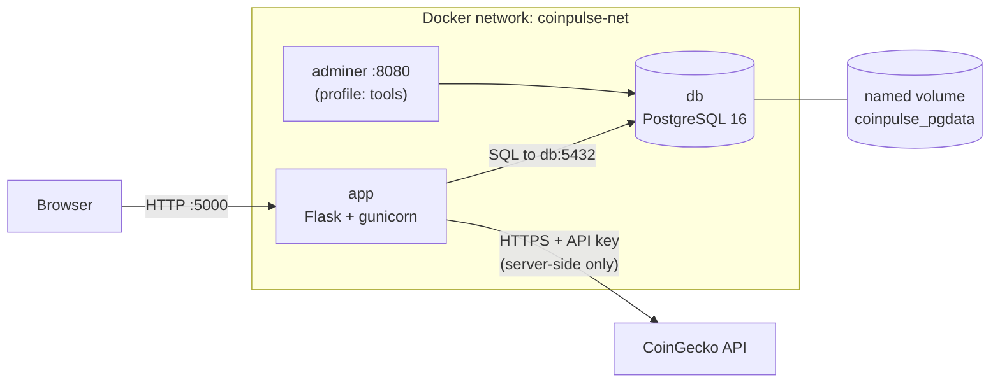
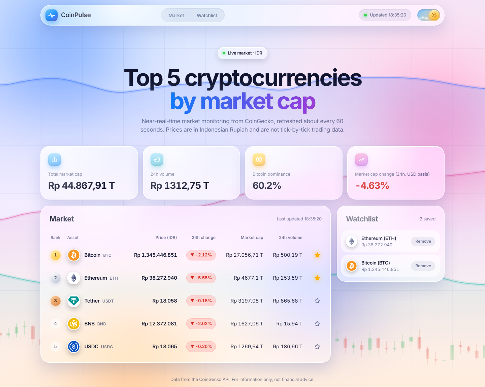
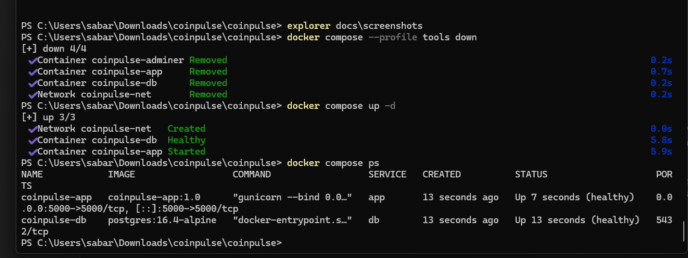
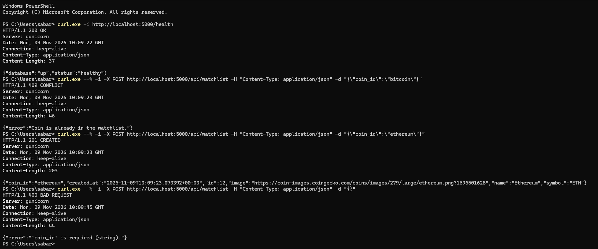
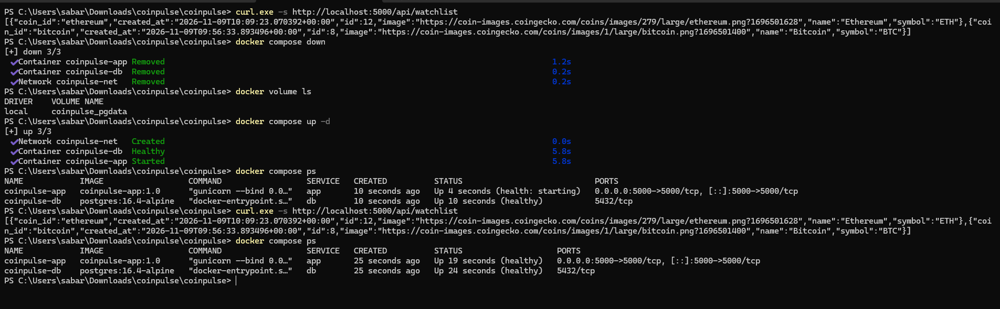
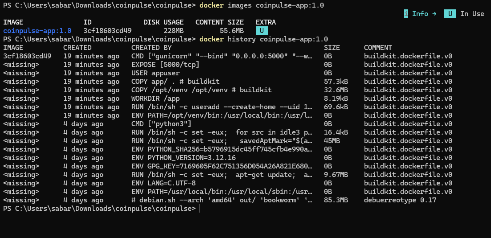
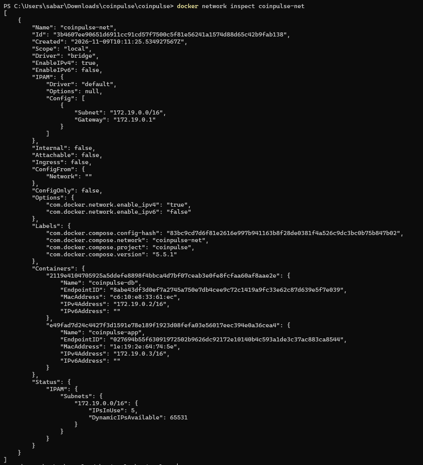

# CoinPulse – Crypto Market Dashboard

A containerized web dashboard that shows the **top 5 cryptocurrencies by market capitalization** in Indonesian Rupiah (IDR), with a personal watchlist stored in PostgreSQL. It runs with a single command: `docker compose up -d --build`.

> **Author:** Winsen Cristiano Sun · **Project:** Cloud Services (Binus University)


## Description

CoinPulse gives **near-real-time market monitoring** (data refreshed about every 60 seconds): price, 24h change, market cap and 24h volume for the five largest coins, plus a market overview (total market cap, volume, Bitcoin dominance). Coins can be starred into a watchlist that survives browser refreshes and container restarts. It is not tick-by-tick trading data and is not financial advice.

## Why this project

CoinPulse is a Cloud Services project at Binus University, built around Docker and containerization. I wanted a project that genuinely needs **more than one container** and talks to **something outside my own code**:

- **Live data from an external API.** A crypto dashboard needs fresh data from CoinGecko, which also makes the API key a real secret to protect.
- **A database that must outlive its container.** The watchlist gives a concrete reason to use PostgreSQL and a named volume, and to test persistence.
- **A web interface for the user.** Flask serves a small responsive frontend, so the whole flow (browser → app → database) can be shown and tested.

Containers fit this better than virtual machines: each service is small and starts in about a second, containers share the host kernel (isolated with namespaces, limited with cgroups) instead of booting a full guest OS, and anyone can reproduce the exact environment with one command.

## Technology Stack

| Layer | Technology |
|---|---|
| Frontend | HTML5, CSS3, vanilla JavaScript (glass UI, light/dark theme) |
| Backend | Python 3.12, Flask, gunicorn (REST API) |
| Database | PostgreSQL 16 |
| External API | CoinGecko API |
| Containers | Docker (multi-stage Dockerfile), Docker Compose |
| DB admin (optional) | Adminer (Compose profile `tools`) |

## Getting Started

**Prerequisites:** [Docker Desktop](https://www.docker.com/products/docker-desktop/) (or Docker Engine with Compose v2) and Git. A free [CoinGecko Demo API key](https://www.coingecko.com/en/api) is optional but recommended for stable use.

```bash
git clone https://github.com/yoisen06/coinpulse.git
cd coinpulse
cp .env.example .env          # Windows PowerShell: copy .env.example .env
docker compose up -d --build
```

Then open **http://localhost:5000**.

`.env.example` already contains working defaults, so these three commands are enough to run the project. Optionally edit `.env` to set your own CoinGecko key and database password **before the first start**.

> **Note:** PostgreSQL reads `POSTGRES_PASSWORD` only when it first creates the database volume. If you change the password later, run `docker compose down -v` first (this deletes the data) so the database is created again with the new password.

### Environment configuration

Configuration is read from `.env` (git-ignored, never committed). The committed template is `.env.example`.

| Variable | Description |
|---|---|
| `COINGECKO_API_KEY` | Your CoinGecko Demo API key (optional but recommended) |
| `POSTGRES_USER` | Database user |
| `POSTGRES_PASSWORD` | Database password (choose your own) |
| `POSTGRES_DB` | Database name |
| `CACHE_TTL_SECONDS` | Market data cache duration (default `60`) |

`DB_HOST=db` and `DB_PORT=5432` are set in `docker-compose.yml`. The app connects to the database by its **service name** `db` over the user-defined network `coinpulse-net`.

### Docker commands

```bash
docker compose up -d --build            # build and start
docker compose ps                       # status and health
docker compose logs -f app              # follow app logs
docker compose --profile tools up -d    # also start Adminer (http://localhost:8080)
docker compose down                     # stop and remove containers (data is kept)
docker compose down -v                  # ALSO deletes the database volume (data is lost)
docker images coinpulse-app:1.0         # image size
```

Adminer login: System `PostgreSQL`, Server `db`, and the credentials from your `.env`.

## Architecture



| Container | Image | Port to localhost | Network | Volume |
|---|---|---|---|---|
| `coinpulse-app` | `coinpulse-app:1.0` | **5000** → 5000 | `coinpulse-net` | none |
| `coinpulse-db` | `postgres:16.4-alpine` | none (5432 internal only) | `coinpulse-net` | `coinpulse_pgdata` |
| `coinpulse-adminer` (optional) | `adminer:4.8.1` | **8080** → 8080 | `coinpulse-net` | none |

**Request flow**

1. The browser loads the page from Flask on port 5000, and `app.js` calls `/api/market` every 60 seconds.
2. Flask returns cached data if it is fresh. Otherwise it calls CoinGecko using the API key from the environment.
3. If CoinGecko fails, Flask returns the last cached data marked `stale: true`. With no cache at all it returns 503 and the UI shows an error state.
4. Watchlist actions go to `/api/watchlist`, and Flask runs parameterized SQL against the `db` service.

The API key never reaches the browser. PostgreSQL is not published to the host. The database waits for its healthcheck (`pg_isready`) before the app starts (`depends_on` with `condition: service_healthy`).

More detail: [docs/architecture.md](docs/architecture.md)

## Features

- Top 5 coins by market cap, fetched dynamically (not hardcoded)
- Name, symbol, logo, price (IDR), 24h change, market cap, 24h volume
- Market overview: total market cap, 24h volume, Bitcoin dominance, 24h market cap change (CoinGecko `/global`)
- Watchlist stored in PostgreSQL that survives browser refreshes and container restarts
- Backend caching (60s) with a stale-data fallback and retry backoff
- Loading, error, and empty states, and a visible "last updated" indicator
- Responsive "liquid glass" interface with a light/dark theme switch (remembers your choice) and a decorative animated background chart

## Screenshots

| Light mode | Dark mode |
|---|---|
|  |  |

**`docker compose ps`: all services running, database healthy**



**API tests with curl: status codes 200, 409, 201 and 400**



**Persistence test: data still there after `down` and `up -d`**



**Image layers and user-defined network**





## API Documentation

| Method | Endpoint | Description | Responses |
|---|---|---|---|
| GET | `/health` | App and database health | 200, 503 if the database is down |
| GET | `/api/market` | Top 5 coins plus market summary | 200, 503 if unavailable and nothing cached |
| GET | `/api/watchlist` | List saved entries | 200 |
| POST | `/api/watchlist` | Add a coin (`{"coin_id": "bitcoin"}`) | 201, 400 invalid input, 409 duplicate |
| DELETE | `/api/watchlist/{id}` | Remove an entry | 204, 404 not found |

`coin_id` must be one of the current top 5 coins.

```bash
curl http://localhost:5000/health
curl http://localhost:5000/api/market
curl -X POST http://localhost:5000/api/watchlist \
  -H "Content-Type: application/json" -d '{"coin_id":"bitcoin"}'
curl -X DELETE http://localhost:5000/api/watchlist/1
```

`/api/market` returns `coins`, `summary`, `updated_at`, and `stale`.

## Persistence Test

1. Add a coin to the watchlist (star icon, or the POST request above).
2. `docker compose down`
3. `docker compose up -d`
4. `curl http://localhost:5000/api/watchlist` shows the same entry, because the data lives in the named volume `coinpulse_pgdata`.

`docker compose down` removes the containers and the network but **keeps** named volumes. `docker compose down -v` removes the volume too, so the database starts empty next time (the app recreates its table automatically, but the saved watchlist is gone).

## Project Structure

```text
coinpulse/
├── app/
│   ├── app.py            # Flask routes
│   ├── market.py         # CoinGecko client, cache, stale fallback
│   ├── database.py       # PostgreSQL access
│   ├── templates/index.html
│   └── static/{css/style.css, js/app.js, js/chart-bg.js}
├── docs/                 # architecture, article, video script, screenshots
├── Dockerfile            # multi-stage build (builder → runtime)
├── docker-compose.yml    # app + db + adminer (profile: tools)
├── requirements.txt
├── .dockerignore  .gitignore  .env.example
└── README.md
```

## Project Links

- **GitHub repository:** https://github.com/yoisen06/coinpulse
- **Article:** _coming soon_
- **YouTube demo:** _coming soon_

## AI Usage Declaration

This project was developed with assistance from Claude (Anthropic), an AI assistant used through an AI coding tool. The AI helped with:

- designing the architecture and drafting the Flask backend, Dockerfile and Docker Compose configuration;
- writing the documentation in `docs/` and this README;
- the visual redesign of the frontend (glass-style interface, light/dark theme switch, animated background chart);
- preparing the written assignment answers.

The author ran the application locally, tested the API endpoints and the persistence behavior (screenshots in `docs/screenshots/`), and is responsible for the final submission.

## Disclaimer

Market data comes from CoinGecko and is for information only. It is not financial advice.
