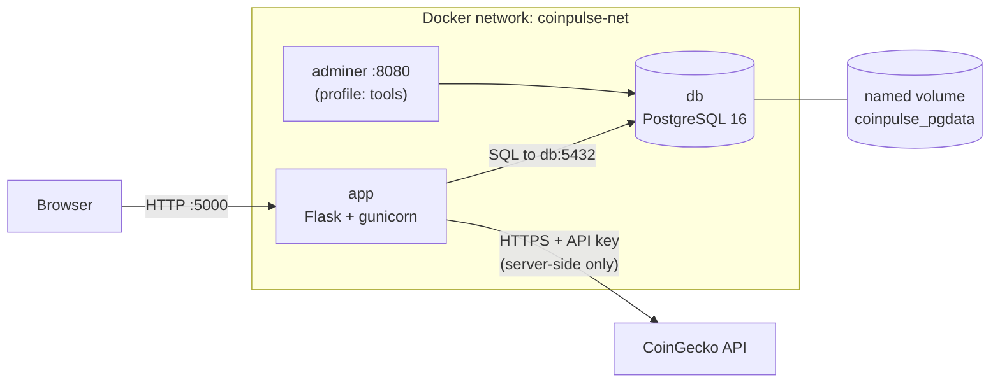

# CoinPulse – Architecture and Docker Explanation

**Winsen Cristiano Sun · Cloud Services project**

## A. Architecture

### Diagram



Plain-text version (for documents that don't render Mermaid):

```text
Browser (localhost:5000)
   │  HTML/CSS/JS served by Flask
   ▼
┌──────────────── Docker network: coinpulse-net ────────────────┐
│  app (Flask + gunicorn) :5000 ───SQL, host "db"──► db (PostgreSQL 16)
│                                                     :5432 (internal only)
│  adminer :8080 (profile "tools") ──────────────────►   │
│                                                         ▼
│                                       named volume: coinpulse_pgdata
└────────┼──────────────────────────────────────────────────────┘
         ▼ HTTPS + API key (server-side only)
   CoinGecko Demo API
```

### Ports

| Service | Container port | Host port | Notes |
|---|---|---|---|
| app | 5000 | 5000 | Dashboard and REST API |
| db | 5432 | not published | Reachable only inside the network |
| adminer | 8080 | 8080 | Only with `--profile tools` |

### Request flow

1. The browser requests `http://localhost:5000/`. Docker forwards host port 5000 to the `app` container, and Flask returns the HTML page.
2. `app.js` calls `/api/market` right away and then every 60 seconds.
3. Flask checks its in-memory cache. If the data is younger than 60 seconds it is returned immediately.
4. Otherwise Flask calls CoinGecko over HTTPS with the API key from an environment variable. The key never appears in frontend code.
5. If CoinGecko fails, Flask returns the last good data marked `stale`. With no cache it returns 503.
6. For the watchlist, the browser calls `/api/watchlist`. Flask connects to the host name `db` (Docker DNS resolves it to the database container) and runs parameterized SQL.
7. PostgreSQL stores its files in the named volume, so the data outlives the container.

### Containers vs virtual machines

| | Containers | Virtual machines |
|---|---|---|
| Isolation | Processes isolated by the host kernel | Full guest OS on virtual hardware |
| Kernel | Shared with the host | Each VM has its own |
| Startup | Seconds or less | Typically tens of seconds to minutes |
| Resource usage | Megabytes of overhead; only the app's processes | Gigabytes; a whole OS per VM |
| Portability | Image runs the same anywhere Docker runs | Larger disk images, hypervisor-specific |

**Namespaces** give each container its own view of the system: process IDs (`pid`), network interfaces (`net`), mount points (`mnt`), hostname (`uts`), inter-process communication (`ipc`), and users (`user`). **Cgroups** (control groups) limit and account for resources such as CPU and memory per container. Together they isolate processes without a separate OS. The trade-off is weaker isolation than a VM, because all containers share one kernel. On Windows and macOS, Docker Desktop runs a lightweight Linux VM and the containers run inside it.

---

## B. Dockerfile explanation

### Multi-stage build

The Dockerfile has two stages:

- **builder** (`python:3.12-slim-bookworm`): creates a virtual environment at `/opt/venv` and runs `pip install`.
- **runtime** (`python:3.12-slim-bookworm`): copies only `/opt/venv` and the `app/` folder. pip's cache and build leftovers stay in the builder stage and are discarded, so the final image is smaller. The container runs as a non-root user (`appuser`).

Both stages use a pinned base image tag instead of `latest`, so builds are reproducible.

### Dependency caching

Docker caches each instruction as a layer and reuses it if nothing above it changed. `requirements.txt` is copied and installed **before** the application code, so editing `app.py` or the frontend does not trigger a reinstall of dependencies. Only the final `COPY app/ .` layer is rebuilt.

### COPY vs ADD

- `COPY` copies files and folders from the build context into the image. It does exactly that and nothing more.
- `ADD` does the same, but also extracts local tar archives and can download from URLs.

Because `ADD` has these extra behaviors, best practice is to use `COPY` unless you specifically need them. CoinPulse uses only `COPY`.

### `.dockerignore`

It lists files that must not be sent to the Docker daemon as build context: `.git`, `.env` (secrets), `__pycache__`, editor folders, docs, and so on. This keeps the context small, speeds up builds, avoids busting the cache with irrelevant changes, and prevents secrets from ending up in the image.

### Image size

The size depends on your machine's build, so measure it yourself:

```bash
docker images coinpulse-app:1.0
docker history coinpulse-app:1.0
```

Measured result: **228 MB** (`coinpulse-app:1.0`), on top of the 188 MB `python:3.12-slim-bookworm` base image. Size comes from the slim base image, `--no-cache-dir` for pip, and the runtime stage having no build leftovers.

A single-stage build of this same app measured 211 MB, because every dependency here is a prebuilt wheel and nothing needs a compiler, so the virtual environment copy adds about 17 MB. Multi-stage pays off when a package must be compiled: in a separate test, building `psycopg2` from source gave 633 MB single-stage versus 222 MB multi-stage.

---

## C. Docker Compose explanation

### Services

| Service | Image | Role |
|---|---|---|
| `app` | built from the Dockerfile | Flask API and dashboard |
| `db` | `postgres:16.4-alpine` | PostgreSQL database |
| `adminer` | `adminer:4.8.1` | Optional database web UI (profile `tools`) |

### User-defined network and service-name DNS

All services join `coinpulse-net`, a user-defined bridge network. On a user-defined network Docker runs an internal DNS server, so containers reach each other by service name. The app connects to the host `db` instead of an IP address, which is important because container IPs can change on every restart. Containers on this network are isolated from containers on other networks.

### Named volume

`pgdata` (created as `coinpulse_pgdata`) is mounted at `/var/lib/postgresql/data`. It is managed by Docker and independent of any container's lifecycle.

- `docker compose down` removes containers and the network but **keeps** the volume, so the watchlist survives.
- `docker compose down -v` also removes named volumes, which **permanently deletes the database data**.

### Healthchecks and `depends_on`

`db` runs `pg_isready` every 5 seconds. `app` and `adminer` declare `depends_on: db: condition: service_healthy`, so they start only after PostgreSQL actually accepts connections. A plain `depends_on` would only wait for the container to start, not for the database to be ready. The app also retries its connection at startup as a second safeguard. `app` has its own healthcheck that calls `/health`.

### Environment variables

Secrets and settings live in `.env`, which Compose reads automatically and substitutes into `docker-compose.yml` (`${POSTGRES_PASSWORD}`). `.env` is git-ignored, and `.env.example` documents the keys without real values. This keeps the API key and the database password out of the repository and out of the code.

### Profiles

`adminer` has `profiles: ["tools"]`, so it is skipped by a normal `docker compose up`. It only starts when you run `docker compose --profile tools up -d`. This keeps optional tooling out of the default stack.
