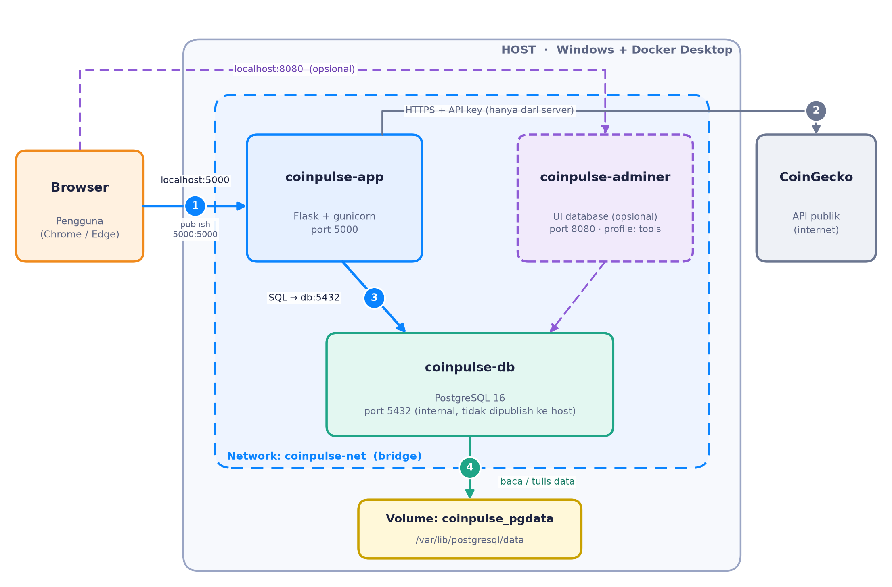
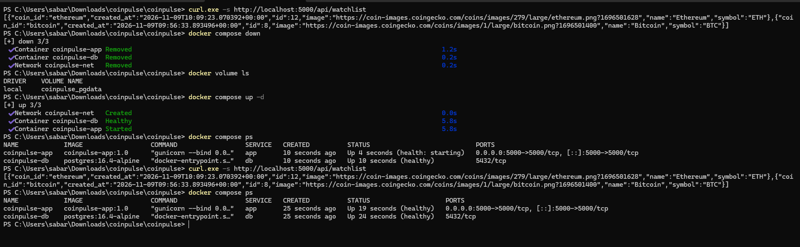

# Building CoinPulse: A Containerized Crypto Dashboard with Flask, PostgreSQL and Docker Compose

*One command, three containers, and data that survives restarts.*

## Why I built it

For my Cloud Services course I wanted a project that needed more than one container and talked to something outside my own code. A crypto dashboard fit well: it needs live data from an external API, a database to keep user data, and a web interface. CoinPulse shows the top five cryptocurrencies by market cap in Indonesian Rupiah, with a personal watchlist saved in PostgreSQL. It is near-real-time (refreshed about every 60 seconds), not trading data. It also points in the direction I want for my career: cloud and DevOps engineering.


## Architecture



The browser only talks to Flask on port 5000. Flask calls the CoinGecko API and talks to PostgreSQL over a user-defined network, using the service name `db`. The API key stays on the server and never reaches the browser's JavaScript. PostgreSQL is not published to my machine, and its data lives in a named volume. Adminer, an optional database UI, sits in a Compose profile.

## The Dockerfile

```dockerfile
FROM python:3.12-slim-bookworm AS builder
WORKDIR /build
RUN python -m venv /opt/venv
ENV PATH="/opt/venv/bin:$PATH"
COPY requirements.txt .
RUN pip install --no-cache-dir -r requirements.txt

FROM python:3.12-slim-bookworm AS runtime
ENV PATH="/opt/venv/bin:$PATH"
RUN useradd --create-home --uid 1000 appuser
WORKDIR /app
COPY --from=builder /opt/venv /opt/venv
COPY app/ .
USER appuser
CMD ["gunicorn", "--bind", "0.0.0.0:5000", "app:app"]
```

*(shortened; full file in the repo)*

Three decisions matter here. First, a multi-stage build: dependencies are installed in `builder`, and `runtime` copies only the virtual environment and the code. Second, a pinned base tag instead of `latest`. Third, `requirements.txt` is copied before the source, so Docker reuses the cached dependency layer when only code changes. I also used `COPY` instead of `ADD` (which can download URLs and extract archives, neither of which I needed), ran as a non-root user, and used the exec form of `CMD`. The final image is 228 MB.

## docker-compose.yml

```yaml
services:
  app:
    build: .
    ports: ["5000:5000"]
    environment:
      DB_HOST: db              # service name, not an IP
    depends_on:
      db:
        condition: service_healthy
  db:
    image: postgres:16.4-alpine
    volumes:
      - pgdata:/var/lib/postgresql/data
    healthcheck:
      test: ["CMD-SHELL", "pg_isready -U $${POSTGRES_USER} -d $${POSTGRES_DB}"]
  adminer:
    image: adminer:4.8.1
    profiles: ["tools"]
volumes:
  pgdata:
    name: coinpulse_pgdata
```

*(excerpt; the real file also sets the network, environment and restart policy)*

- **Service-name DNS:** on a custom network the app reaches the database as `db`. Container IPs change, and `localhost` inside the app container points to the app itself.
- **`service_healthy`:** plain `depends_on` only waits for the container to start. The healthcheck waits until PostgreSQL accepts connections.
- **Named volume:** the data stays when containers are removed.
- **Profile:** Adminer only starts with `--profile tools`.
- **Secrets:** values come from `.env`, which is git-ignored. Only `.env.example` is committed.

## Run it locally

```bash
git clone https://github.com/yoisen06/coinpulse.git
cd coinpulse
cp .env.example .env
docker compose up -d --build
```

Open http://localhost:5000. The database becomes healthy first, then the app starts.

## Does the data persist?

I starred two coins, ran `docker compose down`, then `docker compose up -d`. The watchlist was still there, because it lives in the volume, not in the container. `docker compose down -v` would delete the volume and the data with it.



## What I learned

1. **Test from a fresh clone.** It worked on my machine, but my first clean clone returned 503: CoinGecko rejected the placeholder API key from `.env.example`. Now the app ignores empty or placeholder keys.
2. **Multi-stage is not automatically smaller.** For this app, a single-stage image was 211 MB and multi-stage 228 MB, because every dependency is a prebuilt wheel. When I compiled `psycopg2` from source it was 633 MB versus 222 MB. The pattern pays off when a compiler is needed.
3. **Healthy is not started.** Waiting for a healthcheck removed the startup race between the app and the database.
4. **`POSTGRES_PASSWORD` is only read when the volume is first created.** Changing it later needs `docker compose down -v`.

## Links

- GitHub: https://github.com/yoisen06/coinpulse
- Video demo: <YOUTUBE-URL>

I built this with help from an AI assistant (Claude); the README has the details.
